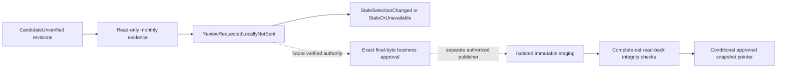

# Approval and publishing foundation

## Current status and trust boundary

Branch feature/approval-publishing-foundation starts from main 36f8f20, the owner's
merge of integration PR #14. The owner reports January/February processing,
financial-v2 reconciliation, real Power BI Desktop imports, and reading raw reports
from a Windows OneDrive-synchronized SharePoint folder. These are useful manual
compatibility observations, not automatic synchronization verification, verified
reviewer identity, business approval or production-publishing authorization.

| Capability | This milestone | Future requirement |
|---|---|---|
| Monthly evidence | Real selected candidates/counts/warnings/nulls/financial summaries/hashes | Independently confirmed business expectations and reviewer decisions |
| Review request | Local durable append-only ledger; request status/fingerprint rechecked against current selections | Delivery/routing and independently authenticated request ownership |
| Final approval | Disabled, including API calls | Authoritative identity AND reviewer permission verification |
| Publishing | Disabled; no production/storage transport | Approved final-byte representation, shared controls and explicit authorization |
| Upload/recovery/rollback | Volatile in-memory protocol model with synthetic mock grants | Durable server implementation and authorized failure/recovery pilot |
| Published history | Truthfully unavailable in desktop | Authorized publication-service history read |
| Power BI | Existing v2/four datasets and relationships preserved | Separate approved-snapshot connector/model migration |

No cleaner, financial calculation/schema, processing SQLite migration, candidate
approval state, approved directory or production PBIX/SharePoint resource changes.
The model never constructs Graph/MSAL or accepts a storage/path transport. Its mock
grants are not business approvals and cannot be imported into the local request
service. Direct Graph and publication remain unavailable.

## State and component design



Only the solid candidate/evidence/request/stale path is implemented for actual
application data. Staging/verification/selection is an **in-memory specification
model**, not a production publisher. Future approval requires:

- Tenant-bound authenticated immutable reviewer identity (not a typed name,
  local username, checkbox, token-cache presence or correction token).
- Independent role/resource permission verification by an authoritative service,
  including revocation/expiry and separation-of-duties policy approved by the owner.
- Evidence of independent source expectations and accepted discrepancies, nulls,
  completeness, exclusion/date/hour/cost decisions and business policy version.
- UTC authority timestamp, reviewer/authorization evidence, report months/types,
  exact source/candidate/summary/final-output hashes, selected revisions, schema and
  cleaner versions. Cryptographic signing or access-controlled authoritative audit
  storage must prevent a local user from minting their own approval.
- Fresh selection/hash/permission checks at approval and immediately before final
  publication. A correction needs new approval; no approval follows a filename.

No such reviewer service is configured. ReviewService.approve always fails closed;
ReviewService.publish always fails closed. A recorded note is an unverified
submitter statement. Requests are not sent by email/Teams/Graph or any other channel.

## Implemented local review

review.py reads current candidates inside one consistent read-only processing
SQLite transaction, checks output bytes against stored hashes, validates normalized
contracts/provenance/date semantics, and recomputes the existing financial-v2
summary checks without modifying values. Captured evidence contains:

- Month and missing required report types; source/retained record counts.
- Original engine warnings and per-column missing-value counts.
- Monthly reported labor/parts/total/count, known individual total and difference/
  unavailable counts. Nulls remain null, never zero-filled or allocated to repairs.
- Exact revision IDs, source/output/summary hashes, cleaner and schema versions.
- Original local-byte checks when the configured raw/month/type/source filename is
  available. Missing/unavailable originals are explicit gaps, not verified sources.
  Changed original bytes reject a request and require normal correction review.

The service does not rediscover history. All three current reports and repair v2
are required to record a request. Incomplete financial evidence can be requested
for human review, but remains visibly incomplete and unapproved. Current zero-
activity completeness policy remains unchanged; do not fabricate a report.

A canonical SHA-256 fingerprint binds selections **and evidence**. Request writes
recapture evidence and compare the displayed fingerprint. Status reads recapture
current selections/source evidence; corrected revisions or changed/missing sources
make prior requests stale/unavailable. Processing is not locked across this separate
request write: a concurrent correction can create an immediately stale request,
never a valid approval. Old request bytes are retained rather than rewritten.

The separate trusted-local powerbi_candidates/review_requests/requests.sqlite3
ledger stores versioned request IDs, UTC local-clock request time, evidence/note,
fingerprint, and explicit null reviewer/approval fields. SQLite uniqueness and
BEGIN IMMEDIATE deduplicate simultaneous identical local requests. Update/delete
triggers enforce ordinary append-only access; body hashes detect accidental edits.
Read-only listing creates no absent store. Failed writes preserve candidates and
previous requests. Only local single-store concurrency is claimed.

**Audit limit:** the local user controls this database and clock. Triggers/hashes
are not signatures or tamper-proof enterprise audit: a privileged editor can remove
triggers and recompute hashes. No record from this database can confer approval.
Keep it private with local candidate history, outside sync/network folders. Notes
may contain sensitive references: enter only necessary evidence, no credentials,
people's personal details or raw descriptions. Retention/backup policy still needs
an accountable owner. Original reports and processing history are never edited.

## Publishing protocol model and future server algorithm

publication_model.py is deliberately named/modelled as a sandbox. SandboxSnapshot
requires the four dataset names, binds mock selection and per-file hashes; its
identity changes with bytes/selection. MockReviewerAuthority grants are volatile
synthetic allowlist records scoped to exact snapshot and operation. No app control
calls this model; no real review request can become a mock grant automatically.

MemoryPublicationModel exercises these design rules:

1. Verify the exact mock approval and current selection before staging.
2. Retain staged bytes separately; verify transfer equality. Interrupted transfers
   remain unselected; resuming only adds matching bytes to the same snapshot.
3. Revalidate authority, selection, complete byte set and expected pointer generation
   immediately before selection. Repeated selection of the same snapshot is
   idempotent. Two competing operations with one generation yield one winner.
4. Store published revisions immutably and append selection events. Prior revisions
   survive corrections; neither a partial transfer nor a failed conditional selection
   changes the current pointer.
5. Rollback requires a **distinct** mock authorization bound to the prior immutable
   snapshot and expected current generation. It selects a prior snapshot, retains
   both histories, and rejects stale/missing targets.

The RLock/dictionaries simulate a shared service; they do NOT provide cross-machine
locking, durable upload recovery, server ETag semantics, approval security, schema
validation or actual SharePoint integrity. Synthetic model tests prove only model
transitions. Existing real candidate schema validation is independently tested.

A future publisher must use IT-approved stable site/drive/item IDs, isolated staging,
create-only immutable destinations and bounded transfer/read-back hashes; journal
operation/approval IDs durably for unknown outcomes. Verify a complete manifest
before shared selection. Use a server-enforced lease/CAS with expiry/fencing and
an ETag-conditioned pointer; a local lock is insufficient. Recheck approval and
selection after staging, handle permission revocation, and leave prior selection
unchanged on failure. Do not claim multi-file atomic upload. Unknown upload/pointer
outcomes require read/reconcile, not blind retry or deletion. Live create-only,
lease, ETag, read-back and rollback semantics need an authorized test-site pilot.

## Proposed final SharePoint / Power BI structure

These are conceptual names, not configured or created organizational folders:

```text
Raw/YYYY-MM/{repairs,service_orders,tma_work_orders}/
Candidates/                         not production ingestion
PublicationStaging/<operation-id>/  restricted; never Power BI ingestion
ApprovedSnapshots/<snapshot-id>/
  manifest.json                    exact set, months, final hashes, approval references
  tables/repairs/                   one v2 monthly file per selected month
  tables/repair_financial_summary/  one v2 summary row per month
  tables/service_orders/            existing versioned schema
  tables/tma_work_orders/           existing versioned schema
ApprovedSelection/current.json     one conditionally selected immutable snapshot
PublicationAudit/                  authoritative grants and selection/recovery events
Archive/                           unselected retained history, never recursive ingestion
```

The final publisher must **not copy CandidateUnverified CSVs directly into
production ingestion**. Define and review the final approved artifact representation
first: candidate-to-approved provenance, approval status semantics and final bytes
must be explicitly authorized and hash-bound. If validation-status cells change,
that creates new bytes requiring exact final-output approval; do not reuse old
candidate hashes or silently edit signed files. Financial v2 columns/meaning,
null money, text IDs, ISO dates and numeric hours must remain intact.

Power BI should resolve the approved selection once, validate approval/manifest
through the approved service, pin that immutable snapshot for the entire refresh,
and read only its four direct table folders and explicit month list. Never point
Folder.Files at candidates, staging, archive, all snapshots, or versions. Retain
monthly-summary grain; do not expand monthly parts/labor onto repair transactions.
The existing M examples remain candidate-only local pilots, not an implemented
SharePoint pointer/approval connector. Preserve existing table identities, DAX,
Building_Dim/calendar relationships and capacity measures through the backup-PBIX
procedure. Production migration/refresh is not authorized by this milestone.

## Employee preview and testing

Close the app and work from the actual Git clone, not an extracted Downloads ZIP:

```powershell
git fetch origin
git switch feature/approval-publishing-foundation
python -m uv sync --frozen --all-extras
python -m uv run --frozen --all-extras python .github/run_tests.py
python -m uv run --frozen python examples/create_powerbi_pilot.py --repair-financial-v2 --complete-financial-example --output data/approval-demo
python -m uv run --frozen --extra desktop python -m equipment_data_manager.ui.app --settings-file data/approval-preview/settings.toml
```

Choose new demo directories. In Settings select the demo's raw and candidates
folders, confirm trusted local candidate storage, and choose a separate existing
reserved approved folder (created manually for Settings only, never populated).
On Process Reports choose January 2026. Open **Review & Approval → Review candidate**.
Inspect retained/source counts, financial summary, missing values, warnings, exact
revisions/hashes and original-byte check status. Enter a concise synthetic evidence
note and click **Request approval (local)**. Expect ReviewRequestedLocallyNotSent,
null reviewer/approval and blocked publication. Reload/restart to inspect the same
record. Approve/Publish remain disabled; F1 explains why. Publication history says
unavailable, not an assertion that SharePoint has no prior publications.

For correction testing, use normal preview/correction confirmation, then refresh
review evidence: prior request becomes stale and a new request is required. Change
an original raw file without processing to see the source-changed rejection. Choose
a missing month to see missing report types and disabled request. Do not edit
candidate CSVs, financial summaries or databases to simulate approval.

For an offline installed-wheel request demonstration, after generating the demo:

```powershell
python -m uv run --frozen python examples/request_candidate_review.py --candidate-folder data/approval-demo/candidates --raw-folder data/approval-demo/raw --month 2026-01 --note "Synthetic independent evidence reference"
```

This writes only the same local unsent request ledger. Repeated identical requests
reuse one record. No external message or production copy occurs.

## Validation and remaining gates

Run the complete existing isolated runner; on headless Linux provide a display and
--isolate-gui. New tests cover evidence/nulls/provenance, missing reports, source
mutation and corrections, unauthorized claims, disabled approval/publication,
local concurrent/deduplicated audit writes, failed writes/integrity, responsive GUI,
and mock partial upload/resume/conflict/rollback. Existing financial and processing
tests remain unchanged. CI includes both OSes, installed-wheel review demonstration
and actual Windows packaging/smoke on PRs and this feature branch's pushes.

Local results and hosted Windows/Linux results must be recorded separately.
A configured workflow is not observed success. GitHub API currently returns proxy
HTTP 403; if that persists, provide manual PR/check links and do not claim CI passed.

Next gates: designated business/finance/model reviewers and IT-approved authority,
role/revocation/evidence/retention policy; signed final-artifact contract; shared
publication coordinator; authorized nonproduction Graph pilot; managed-PC recovery/
security/accessibility acceptance; then separately approved production rollout.
No current OneDrive observation or real-data arithmetic/import success supplies
those identity, publication or production permissions.

### Observed local validation

507 tests passed with zero failures/errors/skips on Linux, including all 473 baseline
cases. Real source and isolated installed-wheel window checks passed through phase
26, including monthly evidence/local request and separate-process Settings restore.
Wheel/sdist builds and the installed-wheel synthetic two-month readiness/request
demonstration passed. Both OS jobs and feature-push Windows packaging are configured;
GitHub API proxy HTTP 403 prevents hosted status verification. Windows executable,
managed-PC authorization/accessibility and live server behavior are not claimed.
