# Offline cleaning architecture (M1)

```mermaid
flowchart LR
    Caller[CLI or future controller] --> Input[Explicit type, confirmed month, input bytes]
    Input --> Manifest[Lock manifest and check current revision]
    Manifest --> Adapter[Layout guards and original transformation]
    Adapter --> Candidate[CSV candidate plus counts and warnings]
    Candidate --> Review[Check replacement acknowledgement]
    Review --> Revision[Write immutable artifact]
    Revision --> Select[Commit current revision in SQLite]
```



## Python interface

```python
from pathlib import Path
from equipment_data_manager.processing.coordinator import ProcessingCoordinator
from equipment_data_manager.processing.models import ProcessingRequest

engine = ProcessingCoordinator(Path("data/local-candidates"))
request = ProcessingRequest(
    report_type="repairs",
    period="2026-09",  # confirmed by operator/content, never filename alone
    input_path=Path("tests/fixtures/synthetic/repairs_input.csv"),
)
result = engine.process(request)
# Or pass raw_bytes=b"...", source_name="report.csv" instead of input_path.
# process_many([request, ...]) returns ordered results and continues on failure.
```

`ProcessingResult.status` is success, skipped, needs_review or failure. It includes
a safe category `code`, warnings, optional `cleaned` candidate, row counts,
`artifact`/`output_location`, previous revision metadata and a replacement token.
Unknown counts/locations on failures are `None`. `CleanResult` carries bytes,
schema, warnings, counts, confirmed period, cleaner version and calculated repair
metrics. Those metrics are not reconciled source/Power BI totals. Failure messages
omit raw exceptions/cell values. Candidate bytes may contain sensitive report
values; never log/repr the complete result in a real integration. The manifest
does not store raw input bytes or source filenames.

For a corrected month, the first request returns needs_review with previous
hashes/counts and proposed bytes/counts/metrics for caller inspection. No new
artifact or active revision is selected. Re-submit the same request with its
`replacement_token` after reviewing it. The token binds the current revision,
proposed source hash, cleaner version and output hash. Changing any of them
requires new review. This prevents stale acknowledgement; it does not authenticate
the operator or provide an automatic business-data diff.

## Existing logic and supported subset

The repair wrapper calls `clean_repairs_raw` and the original preamble writer.
The service wrapper calls `clean_service_raw` with the confirmed month and retains
the existing plain CSV serialization. Three modules are bundled under
`processing/_legacy`; only absolute `clean.row_clean_common` imports become
relative imports. Tests compare copies with the preserved originals and compare
wrapper outputs against the original transform/writer.

Readers retain pandas type/NA inference. Duration defaults, 12.5 labor rate, repair
counts, costs, date parsing and exclusions are unchanged. Output names are the
year-qualified design names, inside revision directories. Filename month/year
inference and original local `main()`/`process_file()` workflows are never invoked.

Only UTF-8/UTF-8-BOM header-first CSVs are enabled. Required columns are a
conservative list of fields used by the supported transforms (`data_contracts.md`).
Flat service lists may have `Name` or `Location`; competing aliases fail.
Preambles, legacy service context layouts, XLS/XLSX, unknown schemas,
duplicate/blank headers, malformed row widths and unsupported encodings fail
explicitly instead of guessing.

The requests source handles work-order/request-shaped inputs, but **TMA
compatibility cannot be established**. TMA selection fails with
`report_type_awaiting_verified_fixtures`. No TMA adapter is invented. Inventory
depends on missing `dashboard.taxonomy` and is outside this milestone.

## Validation policy

- Reject missing required columns, ambiguous/unknown layouts, empty/no-output
  inputs, nonfinite numeric outputs, and repair results outside the confirmed
  month. Mismatches fail instead of silently adding repair filters.
- Service retains its scheduled-OR-completed month inclusion rule.
- Invalid dates/malformed money produce category/count warnings. Existing date
  exclusions and money-to-zero behavior remain unchanged. Duration heuristics,
  defaults and rate are explicitly unverified. Unknown source columns and excluded
  counts are reported; business records are not deduplicated.
- Every candidate warns `production_accuracy_unverified`. Local success means
  wrapper/structural checks passed, not approval to publish. No source-total
  reconciliation, detailed rejected-row audit or real-world schema proof is claimed.

## Duplicate protection and durability

One selected revision exists per `(report_type, confirmed period)` in SQLite.
Each revision records source/output SHA-256 hashes, cleaner version, counts and
warnings. Identical raw content + cleaner version skips after restart or rename.
An output must still exist and match its hash to skip/replace; missing/tampered
artifacts fail without silent repair or overwrite. Different content or a changed
cleaner version requires review. Filenames are not identities: equal basenames
in different months cannot overwrite, and renaming cannot bypass month review.

SQLite `BEGIN IMMEDIATE` serializes local check/select operations, including the
acknowledgement check. A new exclusive random revision directory holds the staged
CSV; it is flushed, fsynced and renamed within that directory. Only after the
artifact exists is metadata inserted and the active pointer committed. Success
returns after commit. Prior revisions and inputs are never modified.

A failed write/transaction leaves the previous selection intact. Interruption
after file rename and before database commit can leave an **orphan immutable
artifact**; file existence alone never selects it. This is not an atomic
filesystem-plus-database transaction or protection from power-loss corruption.
Readers must use manifest-selected results, never recursively combine `versions/`
CSVs, which include history/orphans. Retain the store for diagnosis after integrity
failure; recover from a trusted backup in a separate reviewed action. Automatic
orphan cleanup, backup/restore UI and flat Power BI export publishing are deferred.

The store assumes a trusted application-controlled local directory and one local
manifest. It does not provide a network-filesystem lease or multiuser SharePoint
commit protocol. Future adapters can consume candidate bytes/metadata after
approved validation and publication controls are implemented.
