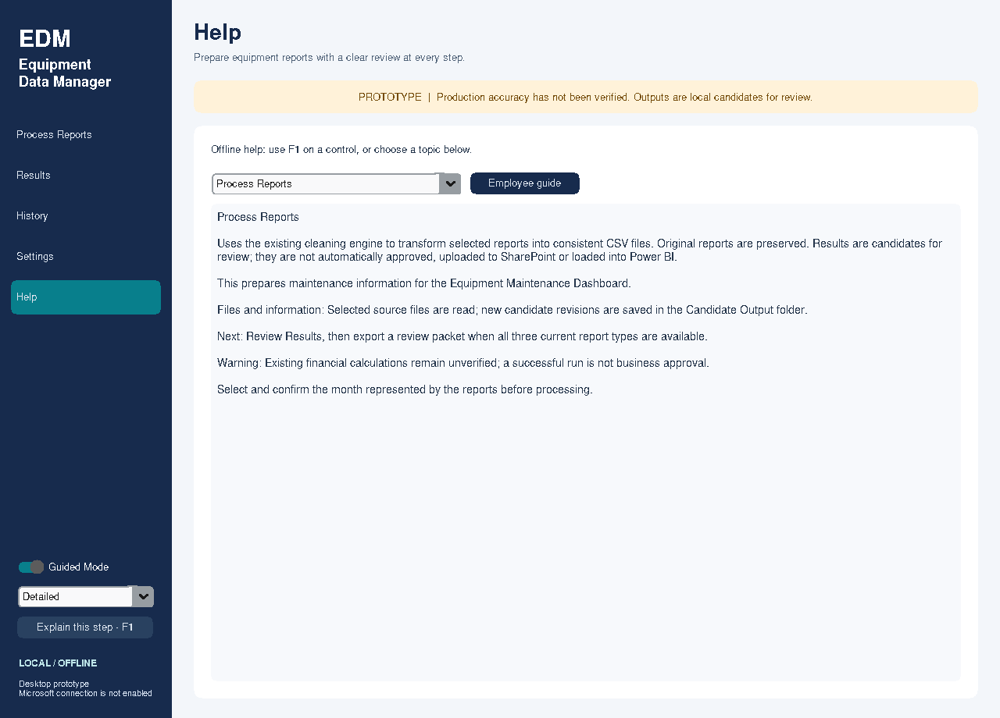

# Guided Mode and help maintenance

**Guided Mode** is on by default, with **Detailed** explanations. The switch and
Brief/Detailed choice are always available in the left navigation, including
during processing. Changes are saved independently of draft folder edits and do
not invalidate a preview, alter a month, approve a correction or change cleaning.
If saving preferences fails, the live help choice remains usable for the session;
use Settings to resolve storage problems. Unreadable settings are not replaced by
a help toggle; explicitly save valid settings to remember that choice.

Hover for about half a second or focus a control to display its explanation.
Brief is a short description plus relevant context/warnings. Detailed adds dashboard
purpose, affected files/information and next steps. Tips have bounded scrollable
text, reposition at display edges, never grab focus and have no reading timeout.
Leave the control/tip, click, navigate, press Esc or switch Guided Mode off to
close them. Disabled controls still have explanations. Keyboard-focusable buttons,
report choices, checkboxes and the help switch support Space/Enter without
activating disabled actions.

Press **F1** for the focused/hovered control's explanation in **Help**, or use
**Explain this step** for state-aware guidance. The Help topic selector makes all
entries available without hover; the bundled **Employee guide** works offline.
Manual Help remains available with Guided Mode off. This is a keyboard-help
alternative, not a claim of certified screen-reader accessibility. Managed-PC
accessibility, multiple monitors and 125/150/200% Windows scaling still require a
manual pilot. Initial window sizes fit the primary scaled display; short displays
use scrollable processing/navigation regions, and Settings keeps its action row
fixed beneath its scrollable form.

## Explanations currently covered

| Area | Registry IDs / behavior |
|---|---|
| Monthly actions | discover, preview, process, packet, correction, month |
| Sources | repairs, service_orders, tma_work_orders; Tim-supplied supported TMA XLSX, legacy XLS remains blocked |
| Formats | powerbi and legacy; selectors explain the currently selected mode |
| Local selection | select_files, sample, output, stop, load_config |
| Safety/results | status, warnings, history; disabled states, missing CSV/XLSX reports, duplicate/correction/date/format errors, saved-candidate and review-packet context |
| Settings | raw_folder, candidate_folder, approved_folder, check_locations, save_settings, reset, import_settings, export_settings |
| Help preferences | guided, detail; also navigation, folder indicators and readonly path fields |

Financial help states that repair field meanings/default/rate reconciliation remains
open. It never advises ignoring warnings, marks candidates approved, or claims
future maintenance classification, synchronization or Microsoft sign-in is implemented.
A report's result-detail panel remains the source for local per-record dates/counts
and engine warnings; tips summarize next steps rather than replacing that evidence.

## Adding a control explanation

1. Add an entry in `src/equipment_data_manager/ui/help_content.py`. `HelpEntry`
   contains control_id, title, brief, detailed, dashboard, affects, next_step,
   optional warning and guide reference. Keep titles unique for the topic picker.
   Write ordinary employee language; do not embed financial formulas in help text.
2. In `EquipmentDataManager.register_guidance`, register the new widget with the
   registry key: `self.guidance.register(self.new_button, 'new_action')`.
   Guidance binds the Tk frame and its child widgets so CTk canvas forwarding does
   not omit focus/disabled-control events. Keep all of this on the main thread.
3. If state changes the explanation, extend `help_context(key)` with a safe
   instruction based on current structured results or workflow state. Do not log
   or include raw descriptions/names/tokens. Never change engine decisions here.
4. Add registry coverage/state tests and a real-widget focus/F1 case when the new
   interaction requires it. Real-widget cases belong in test_desktop_widgets.py
   so the existing isolated runner discovers and runs them on both platforms.
5. Update the employee guide and copy it to resources/guides/user_guide.md; the
   equality test prevents a stale bundled guide. PyInstaller includes that offline
   Markdown resource, and the executable smoke actually opens it.

`ui/guidance.py` handles timers, focus/hover bindings, bounded popup placement and
keyboard alternatives. Popup rendering uses a styled Tk Toplevel/Text so short-lived
tips do not leave CTkToplevel delayed titlebar callbacks behind. The main app stays
CustomTkinter. Help content lives in the registry, not lengthy button handlers.
`ui/preferences.py` serializes asynchronous settings operations separately from
cleaning; help preference writes coalesce and preserve the latest saved folders,
not unsaved form selections. All workers return plain data through queues; no
worker calls Tk. Existing main-thread cyclic-GC ownership remains unchanged.
