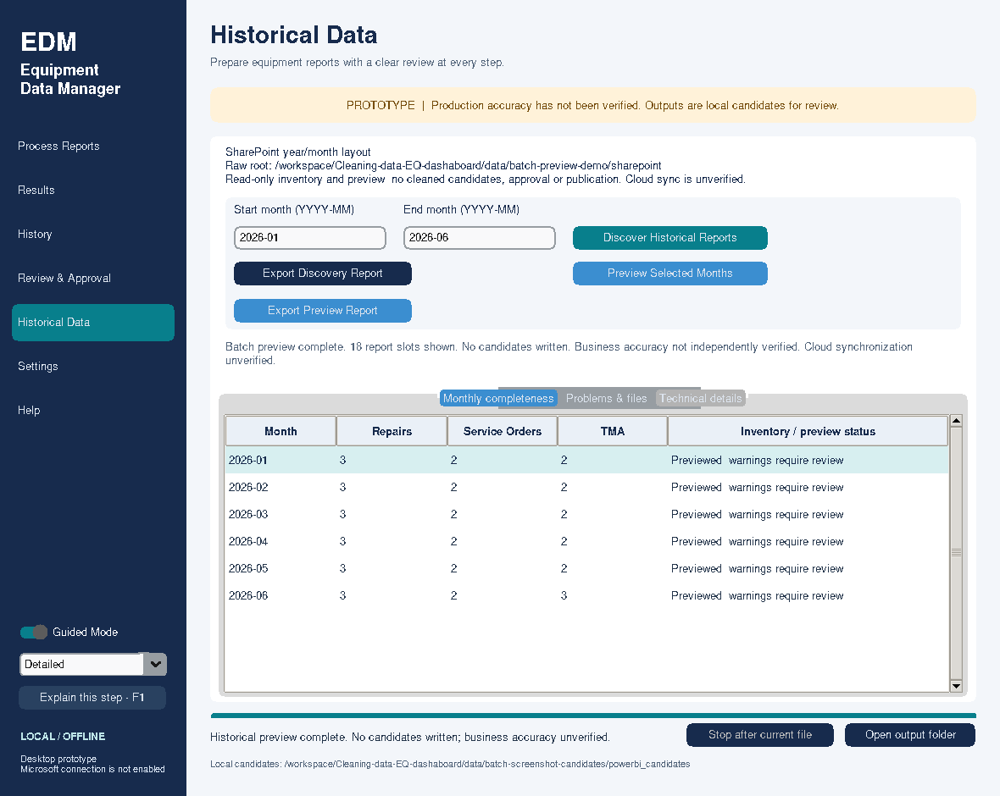

# Historical batch preview

## Historical Batch Processing — current feature

Based on merged main fe5df23 (PR #22). Historical Data adds a reviewed, explicitly
confirmed plan and sequential creation of **local unapproved normalized candidates**.
Unchanged reports skip; corrections stay blocked with a route to existing individual
confirmation. Current revision/proposal/source guards prevent stale replacement.
Cancellation/restart recovery uses committed history and fresh intent, without
resuming old plans. Read-only preview remains unchanged. No approval, publishing,
Graph writes, Power BI refresh or historical snapshot assembly is enabled.
See [workflow, architecture and isolated Windows acceptance](historical_batch_processing.md).
Older sections below describe earlier scope and are superseded by this feature note.


Built from owner-merged `main` f49b297 (PR #21), without replaying historical
branches. Earlier roadmap/backfill entries describe earlier milestones. This
milestone adds **preview only**; batch processing and historical snapshots remain
separate future work. Prior owner May/June acceptance is not financial approval.

## Employee workflow

1. In Settings, keep candidates on trusted local storage. Select the existing raw
   root and its explicit folder layout. For the departmental layout choose the
   folder containing year folders, **not** a single month. Save only intentional
   local application setting changes. Original folders are never reorganized.
2. Open Historical Data. Enter start/end as `YYYY-MM` (inclusive, at most 120).
   Click Discover Historical Reports. Discovery alone checks readable filenames,
   not schemas or financial correctness.
3. Resolve ambiguous files, unsupported extensions and availability problems.
   Missing reports stay visible; they are never assumed to contain zero records.
4. Click **Preview Selected Months**. This means every month in the chosen range,
   with three report slots each. Preview runs the existing adapters in memory,
   sequentially in a background worker. Progress identifies month/report type.
5. Select a month in Monthly completeness and open Problems & files. Read counts,
   existing-rule exclusions, retained-record missing values, observed date checks,
   source-reported financial totals, separate estimated/legacy known sums, and
   warnings. Technical details contains hashes, versions and safe diagnostic codes.
6. Stop ends after the active file and keeps completed results. Remaining slots
   say Not previewed. A failed report does not hide successful reports or months.
7. Export Preview Report optionally saves a **new local diagnostic CSV or JSON**
   outside all three workspace roots, synced/network folders, and approved outputs.
   Existing reports are not overwritten. Pick a short path on Windows. This report
   is not a Power BI dataset, candidate selection, review request or approval.

Range and results survive navigation during the session. Range/results are not
saved across restart; saved root/layout and the separate single-month reporting
selection retain their existing persistence. Changing range/root/layout invalidates
inventory and results. A stopped discovery must be repeated before batch preview.

## What the evidence means

Historical preview uses the current normalized contracts (repair financial v2),
independently of the single-report Legacy export choice. It does not change that
setting; unchanged/correction comparison consults normalized candidate history.

Counts come from the existing adapters. Unknown counts are blank/Not assessed,
never zero. Exclusions report the existing first exclusion reason where CSV
observation is available; TMA exposes its existing aggregate exclusion counter.
Dates are observations from the existing parsers, not a second date parser. CSV
observations cover recorded source rows; some layouts/rejections do not supply
row diagnostics. An unsupported source or early structural rejection may therefore
have no count/date summary. The error still identifies the existing validator.
No missing value, date, assignment or cost is invented.

Missing-field counts describe **retained rows**. TMA also preserves the separate
source-column-absent warning and affected counts. Retained TMA dates pass the
existing selected-month validator; timestamped XLS additionally must pass the
native generation-date/previous-month checks. XLSX footer checks, BIFF8 structure
checks and formatting-only-edge normalization are unchanged.

Repair totals use the schema-v2 supplemental monthly financial summary computed
in memory. Reported labor/parts/total are separate from estimated labor and legacy
arithmetic. Reconciliation remains arithmetic evidence only. Known sums with a
nonzero missing count are **incomplete**; all-missing values stay unavailable.
No combined multi-month financial total is presented, avoiding silent aggregation
of incomplete months. Repeated source summaries are handled by the existing cleaner.
A discrepancy is a warning requiring review, not a correction or allocation.

All preview outputs remain business-unverified. The interface never derives
Approved, Verified or Production Ready states from preview success. Candidate
history may identify an unchanged file or potential correction; preview does not
select a revision or authorize replacement. Existing single-month correction
confirmation is still required for actual processing.

## Integrity and privacy

Discovery captures provider/container/file identity, local version and SHA-256.
Before cleaning each source, the same local/synced provider requires matching
identity/version/hash and stable complete bytes. Changed/deleted sources require
rediscovery; changed bytes are not substituted. Evidence is point-in-time and is
not a live file monitor or proof of OneDrive/server synchronization. Cloud-only
files are rejected through the existing provider; use IT's local-availability SOP.

Only one file's raw/cleaned bytes are held during each preview. Result objects
retain aggregates, filenames, hashes and versions, not employee names, request
text, descriptions, raw date strings or original output CSVs. Optional exports
contain stable diagnostic fields; JSON retains safe technical provenance. CSV
filenames beginning with an Excel formula prefix are prefixed with an apostrophe.
Keep these local operational reports private even though cell contents are omitted.

No preview path invokes processing writes, creates a database, CSV candidate,
revision, pointer, review packet, approval request, token cache, network connection
or Power BI refresh. Existing manifests, when present, are consulted read-only.
Export alone creates the explicitly requested diagnostic file (exclusive, fsynced,
cleanup of its own incomplete file on ordinary failure). A process/power failure
can leave an incomplete diagnostic; choose a new filename. Exports are never
importable processing/approval authority.

## Windows acceptance: source checkout, January–June

Use the Git clone, **not** the Downloads prototype folder. Close the running app
before dependency installation to avoid Windows locking its launcher.

```powershell
cd "$env:USERPROFILE\Cleaning-data-EQ-dashaboard"
git status --short
git fetch origin
git switch feature/historical-batch-preview
# First checkout only, if no local branch exists:
# git switch --track origin/feature/historical-batch-preview
git pull --ff-only
git rev-parse HEAD
python -m uv sync --frozen --all-extras
python -m uv run --frozen --all-extras python -c "import equipment_data_manager.historical_preview as m; print(m.__file__)"
python -m uv run --frozen --extra desktop python -m equipment_data_manager.ui.app
```

Do not switch/pull over uncommitted local work. The module path must identify this
checkout. First test the synthetic demonstration on a **new** destination:

```powershell
python -m uv run --frozen python examples/create_historical_batch_demo.py --output data/historical-batch-demo
```

Set Raw root to the absolute `data/historical-batch-demo/sharepoint` directory,
SharePoint year/month layout, and separate local candidate/reserved-approved roots.
Discover/preview `2026-01` through `2026-06`. All 18 slots should preview; invented
retained counts are repairs 3/month, services 2/month, TMA 2 for January–May and
3 for June. Repair reported total is an invented $30/month. Warnings remain visible.
This demonstrates XLSX, classic XLS and timestamped XLS; it is not departmental data.
Repeat using the demo's `standard` root and Standard layout. No candidate store
should appear. Source, wheel and packaged smoke checks also exercise batch preview.

Then deliberately select the **existing authorized local raw-folder copy** in
Settings and preview January–June. Record actual counts/exclusions/date and
financial warnings without forcing illustrative counts. Prior owner observations
May 81/June 70 are comparison evidence, subject to the unchanged rules. Review any
missing costs or financial differences independently. No real report is uploaded
by the application or committed to Git. Test cancellation, a missing month, and
stale rediscovery only with disposable synthetic copies; preserve departmental
originals. Export a local diagnostic outside the workspace and verify no candidate
CSV/database/approval state changed. Restart: root/layout/single-month selection
restore; historical evidence requires rediscovery.

## Diagnostic CSV contract

One row per month/report slot. Stable columns are `Purpose`, `ReportingMonth`,
`ReportType`, `SourceFilename`, `SourceRecordCount`, `RetainedRecordCount`,
`ExcludedRecordCount`, `ExclusionCounts`, `MissingRetainedValueCounts`,
`DateObservationCounts`, `FinancialStatus`, `ReportedLaborCost`,
`ReportedPartsCost`, `ReportedTotalCost`, `MissingReportedCostCount`,
`FinancialSummary`, `WarningCodes`, `PreviewStatus`, `ReasonCode`, `SourceIntegrity`, `FailureScope`,
`IgnoredExtraFilesInMonth`. The last count repeats per report slot: count once
per month, not once per report.
Counts/maps use JSON within their quoted CSV cells. Missing counts/money remain
blank, financial-detail nulls stay JSON null, and non-repair financial fields stay
blank. Reported money columns are source monthly totals, not estimates. Known
retained sums and their completeness counters remain in FinancialSummary.



## Developer and native package acceptance

```powershell
python -m uv run --frozen --all-extras python .github/run_tests.py --isolate-gui
python -m uv build
python -m uv run --frozen --extra desktop python -m equipment_data_manager.ui.app --smoke-test --smoke-dir data/batch-source-smoke
python -m uv run --isolated --no-project --with './dist/equipment_data_manager-0.2.0-py3-none-any.whl[desktop,microsoft]' python -I -m equipment_data_manager.ui.app --smoke-test --smoke-dir data/batch-wheel-smoke
.\packaging\build.ps1
$smoke = Join-Path $PWD 'data/batch-packaged-smoke'
$p = Start-Process -FilePath '.\dist\EquipmentDataManager\EquipmentDataManager.exe' -ArgumentList @('--smoke-test','--smoke-dir', $smoke) -PassThru
if (-not $p.WaitForExit(120000)) { $p.Kill(); throw 'Smoke timeout' }
if ($p.ExitCode -ne 0) { throw 'Packaged smoke failed' }
Get-Content "$smoke/desktop-smoke.json"
Get-Content "$smoke/restore-smoke.json"
```

Require smoke status `passed` (including batch phases and fresh-process restart),
not merely an executable/window. On Linux, use a display/Xvfb for GUI checks.
Never run GUI suites and smoke simultaneously on one display. CI schedules the
full Linux/Windows matrix and Windows package/component/desktop/restart checks on
this feature branch's pushes. Configuration is not evidence of a passing hosted
run. Native Windows execution cannot be inferred from Linux tests or wheel builds.


## January temporary-file mapping correction

Only `historical_temporary_file_ignored` is an ignored-extra notice rather than a
month-wide batch failure. Valid reports still require their own stable read and
adapter checks. JSON inventory_notices and employee details report ignored extras
separately; actual report errors have their own failure_scope. All other blockers
remain. See [cause and January–June acceptance](january_batch_preview_fix.md).
