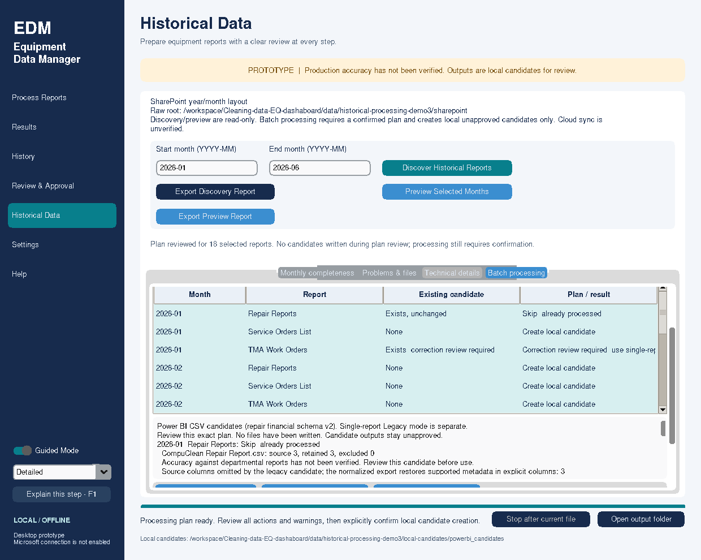
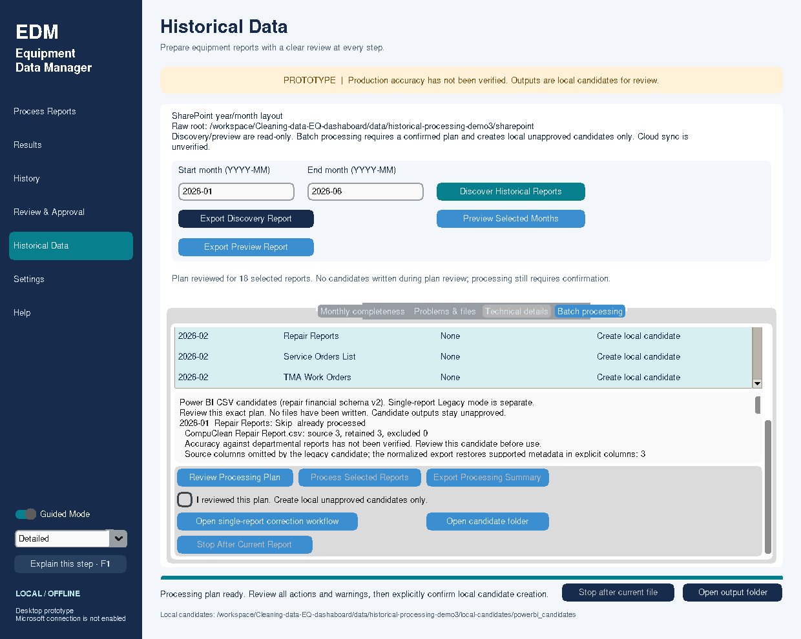

# Historical Batch Processing: local unapproved candidates

Branch `feature/historical-batch-processing` starts at merged main **fe5df23**,
PR #22. The owner accepted all 18 January–June historical previews before this
milestone. That is prior preview evidence, not acceptance of this new write workflow
or blanket business approval of historical finances.

## Employee workflow

1. In Settings choose an authorized local/synced raw root, its explicit layout,
   a **trusted local candidate folder**, and a separate reserved approved folder.
2. In Historical Data select the range, Discover, then Preview Selected Months.
   These two operations remain read-only. Inspect missing files, counts, date
   issues, exclusions, financial gaps and assignment warnings as before.
3. Open **Batch processing → Historical Batch Processing**. Select individual
   report rows with Ctrl/Shift-click, add individual months with Select month,
   and use the three report-type checkboxes to filter inclusion. Select all eligible
   reports selects successful previews, including unchanged candidates; it excludes
   known corrections. Clear selection resets the plan. The panel scrolls vertically
   on smaller screens; scroll to the confirmation controls if needed.
4. Click **Review Processing Plan**. This reads current history and rechecks each
   selected source. It writes no candidate files or database. Review each filename,
   month/type, existing candidate, proposed action, counts and warnings. Technical
   details contains exact revisions, cleaner versions, proposed hashes and provenance.
5. Check **I reviewed this plan. Create local unapproved candidates only**, then
   click **Process Selected Reports** and confirm the final dialog. The statement
   records processing intent; it does not establish business approval or identity.
6. New eligible files create ordinary immutable candidates. Identical existing
   candidates skip. Corrections remain blocked here and cannot be authorized by
   the batch confirmation. Select one and click **Open single-report correction
   workflow** to confirm its month, preview again and use its existing specific
   replacement confirmation. That route intentionally changes the single-report
   month and format. No correction token is included in a batch plan.
7. Watch month/report progress. **Stop After Current Report** finishes an active
   atomic commit, then marks later items Not started. Successful candidates remain.
   A report failure does not hide successful reports or later safe work.
8. Read summary counts and retained records by report type. Retained totals cover
   **created/unchanged candidates only**, excluding blocked/failed/not-started rows.
   Select rows for detailed results, financial warnings and local output locations.
   Open candidate folder always opens the normalized candidate store.
9. Export Processing Summary optionally writes a new private diagnostic CSV/JSON
   outside raw/candidate/approved roots and synced/network destinations. It is not
   a Power BI dataset or processing/approval authority. Existing reports are preserved.

Historical processing always uses normalized Power BI CSV contracts (repair v2),
independently of the single-report Legacy export preference. It does not change
that preference or the saved single reporting month during normal batch execution.
New candidate directories contain the same main CSV and repair financial summary
as the ordinary coordinator. They remain `CandidateUnverified`.

## Processing-plan design

The immutable session plan binds selected month/type pairs, source provider,
container identity digest, relative item/parent IDs, original filename, version,
SHA-256, cleaner version, proposed output hash, selected current revision/output
hash, configuration digest and creation time. The configuration binds raw,
candidate and reserved-approved roots plus layout. Duplicate/empty/unknown selections
fail. No source cells, raw date strings, request text or replacement tokens are kept.
The plan fingerprint identifies the exact intent confirmed by the employee.

Plan creation rereads stable source bytes and calls the existing detailed preview.
It compares the original preview's proposal/version with the fresh proposal and
consults real candidate history. Root/layout/source/cleaner/proposal changes block
stale evidence. Existing output differences, including provenance differences,
are conservatively correction-required. If code changes output without changing
its version, the maintainer must correct the version before the existing correction
workflow can treat that behavior change as a new proposal. No guessed equivalence
or silent replacement is introduced; the default single-report API is unchanged.

Execution reads each selected source again through the local/synced provider,
requiring captured identity/version/hash and stable complete bytes. It then calls
`ProcessingCoordinator.process_guarded`, not a second cleaning engine. Under the
ordinary SQLite transaction this opt-in method checks the expected current revision,
cleaner version and exact cleaned-output hash before any revision selection. The
main repair CSV binds its supplemental summary digest, so the same guard also binds
the financial-summary bytes. Old `process` and `preview` calls remain compatible.
A candidate selected by another operation after plan review causes a fresh-plan
block, even if another application created it successfully. Retrying with fresh
history then safely skips an unchanged completed candidate.

Only one in-process batch can execute for a candidate workspace. Other processes
on this machine are protected per report by SQLite serialization and the expected
revision guard. This is not a distributed lease or authorization for concurrent
employees writing shared/network/synced candidate stores. Those remain unsupported.

Candidate root, normalized store, versions ancestor and manifest redirects are
rejected; existing local-storage policy is preserved. Classic Windows full-path
preflight checks main/staging/financial paths before a new revision directory is
created (260 UTF-16 file units, conservative 248 parent units). Use a shorter local
root if blocked; do not enable an unsafe-location fallback.

## Financial and validation behavior

No source cleaner, exclusion, date, duration/rate or cost calculation changes.
Reported monthly labor/parts/total, known individual repair totals, estimated labor
and legacy calculations retain schema-v2 meaning. Missing values stay missing.
Financial incompleteness may create an unapproved candidate only when the existing
single-report cleaner permits it. Existing blocking validation remains blocking.
No differences are allocated, repaired or converted into approval.

Warnings/exclusion/date/missing-value aggregates are reused from the existing
preview/cleaner results. Invalid/missing reports do not become zero-record outputs.
TMA XLSX footer checks, genuine BIFF8, timestamped generation-month checks,
formatting-only-edge rules and blank assignments remain unchanged. Temporary extras
continue to be ignored separately, never read as a selected source or deleted.

## Interruption and recovery

Plans and run results are session-only. There is **no automatic resume** and no
import of a saved plan/diagnostic. Restart requires discovery, preview, a newly
reviewed plan and explicit confirmation. Within a session a new plan rereads the
sources and current history before any retry. Files altered after preview require
rediscovery/preview; changed bytes are never substituted under the old identity.

The durable manifest is the recovery authority. Revisions selected by committed
transactions survive application closure and are skipped on retry when equivalent.
A current commit is not interrupted by Stop. If the process/power fails before
manifest commit, filesystem work may leave an unselected orphan revision, including
an incomplete artifact set. That directory is **not a valid selected candidate**,
not counted successful, and is never inferred to have completed or ingested.
A fresh confirmed retry creates/selects a complete revision; no orphan cleanup or
history deletion is automatic. Only committed manifest entries are current/history.
Never recursively ingest `versions/` into Power BI.

The whole batch is not one transaction: earlier committed reports survive a later
failure. Failed writes do not replace prior selections. Diagnostic exports are
exclusive/fsynced with owned-partial cleanup using the shared Windows-safe path
validation (links first, extension, local policy, workspace overlap, length).
A hard power/process exit can leave a partial diagnostic; it is not executable state.

## Diagnostic summary contract

JSON records plan fingerprint, UTC run times, selection/result counts, source
identity and hashes, per-report status/reason, revision/output hash/location and
safe warning/financial evidence. It explicitly records approval not granted,
publication disabled and synchronization unverified. CSV has stable columns:
`Purpose, Month, ReportType, SourceFilename, SourceItemId, SourceVersion,
SourceSHA256, Status, ReasonCode, CandidateRevision, OutputSHA256, OutputLocation,
RetainedRecords, WarningCodes, FinancialSummary, Integrity`.
Financial nulls remain null in JSON or blank where applicable. Counts in failed or
blocked evidence may be the last preview counts, not committed output; statuses,
revision fields and summary scope distinguish them. Filenames/paths are private
operational metadata; unnecessary employee names/descriptions/cell text are omitted.
Formula-prefix text is escaped for diagnostic CSV display. Do not commit diagnostics
or use them as Power BI ingestion inputs.

## Exact Windows acceptance: isolated candidate workspace

Close the application before dependency sync. Use the Git clone with preserved/
clean local work; never run these commands in the old Downloads prototype folder.

```powershell
cd "$env:USERPROFILE\Cleaning-data-EQ-dashaboard"
git status --short
git fetch origin
git switch feature/historical-batch-processing
# If no local branch exists: git switch --track origin/feature/historical-batch-processing
git pull --ff-only
git rev-parse HEAD
python -m uv sync --frozen --all-extras
python -m uv run --frozen --all-extras python -c "import equipment_data_manager.historical_processing as p; print(p.__file__)"
python -m uv run --frozen --extra desktop python -m equipment_data_manager.ui.app
```

First use invented samples in a **new** demo destination:

```powershell
python -m uv run --frozen python examples/create_historical_batch_demo.py --output data/batch-processing-demo
```

Set raw root to the absolute `data/batch-processing-demo/sharepoint` directory,
SharePoint year/month layout, and separate trusted local candidate/reserved-approved
folders under a new private pilot directory (for example inside LOCALAPPDATA).
Discover/preview January–June. The synthetic fixture has 3 repairs/2 services each
month, TMA 2 January–May and 3 June; dollar values are invented. Select all eligible,
review, confirm and process. Verify 18 candidates plus repair monthly summaries,
then preview/review/retry: expect skips and unchanged selected revision IDs.
Also test individual months/types, missing reports and Stop using disposable copies.

For real-data acceptance keep the existing authorized read-only local raw copy.
Use a **new candidate test workspace**, not the current working candidate root or
an approved/production output folder. To exercise existing January/February states,
optionally make a private **cold copy of only unapproved normalized candidate
history** after closing all application/CLI writers: copy `manifest.sqlite3` and
its entire `versions` subtree into the new test root's `powerbi_candidates` folder.
Do not copy review requests, review packets, approved outputs or production ingestion
folders. Do not copy an open database or discard SQLite sidecars; if journal/WAL
files remain, have the maintainer prepare a consistent SQLite backup instead.
Never alter the original store. No candidate seed import is automatic in the app.

1. Configure the existing raw root/layout and isolated candidate/reserved-approved
   roots in Settings. Verify the candidate path and module/commit above.
2. Discover `2026-01`–`2026-06`; Preview all 18 and review warnings.
3. Select all eligible rows, then optionally add January/February with Select month
   so correction-required rows also appear in the reviewed plan. They remain blocked.
4. Confirm unchanged January/February rows show Skip. Do not assume those states
   from filenames; actual copied history decides. Leave correction rows unconfirmed.
5. Select eligible March–June rows/types as intended. Review the exact plan, checkbox
   and final dialog, then process. Check candidate output locations, source/output
   hashes, row counts, exclusions, missing values and revision history. Prior
   committed files must retain their hashes and previous revisions must still exist.
6. On a disposable synthetic run, use Stop; verify completed revisions survive and
   later rows are Not started. Restart the app: settings/root/layout/single reporting
   month restore, but no old plan runs. Discover/preview and confirm a new plan.
7. Retry real selections with fresh evidence. Existing equivalent candidates must
   skip, no duplicate revision should be selected, and corrections must remain
   blocked unless specifically completed through the ordinary single-report route.
8. Export a private processing diagnostic outside all workspace/synced folders.
   Do not upload it or point Power BI at it. Reserved approved roots remain untouched.

Prior owner preview observations, **not hardcoded expectations**:

| Month | Repairs | Services | TMA |
|---|---:|---:|---:|
| January | 29 | 29 | 38 |
| February | 5 | 5 | 67 |
| March | 17 | 17 | 69 |
| April | 33 | 35 | 59 |
| May | 55 | 57 | 81 |
| June | 69 | 70 | 70 |

Preserve March's one unavailable repair cost; April's two cross-period service
completion dates; May's seven unavailable costs, one service exclusion and missing
TMA assignments; June's seventeen unavailable costs and missing TMA assignments.
Current inputs/rules decide actual counts. Do not force these values or silently
correct differences. This batch-processing acceptance remains **owner-pending**.

## Build and regression commands

```powershell
python -m uv run --frozen --all-extras python .github/run_tests.py
python -m uv build
python -m uv run --frozen --extra desktop python -m equipment_data_manager.ui.app --smoke-test --smoke-dir data/batch-processing-source
python -m uv run --isolated --no-project --with './dist/equipment_data_manager-0.2.0-py3-none-any.whl[desktop,microsoft]' python -I -m equipment_data_manager.ui.app --smoke-test --smoke-dir data/batch-processing-wheel
.\packaging\build.ps1
$dir = Join-Path $PWD 'data/batch-processing-packaged'
$p = Start-Process -FilePath '.\dist\EquipmentDataManager\EquipmentDataManager.exe' -ArgumentList @('--smoke-test','--smoke-dir',$dir) -PassThru
if (-not $p.WaitForExit(120000)) { $p.Kill(); throw 'Smoke timeout' }
if ($p.ExitCode -ne 0) { throw 'Packaged smoke failed' }
Get-Content "$dir/desktop-smoke.json"
Get-Content "$dir/restore-smoke.json"
```

Require passed phase 45 and passed separate-process restore, not just a window.
The smoke creates February synthetic candidates through a confirmed plan, preserves
correction revisions and then retries without new revisions. It preserves earlier
preview/read-only/temporary/XLS/financial/review/security checks.
On Linux use a display/Xvfb and `--isolate-gui` for the full runner. Never run GUI
suites/smokes simultaneously on one display. Hosted Windows/Linux and native
Windows packaging must pass on the feature head before recommending merge.
No test is skipped; public job-step metadata may verify CI when API access fails.

## Boundaries and next steps

Implemented: local candidate plans/execution, safety guards, results and diagnostics.
Read-only preview is still separate. Single-report corrections remain the supported
replacement route. Automatic resume, batch correction-token management, authenticated
business approval, production publication, Graph writes, historical combined snapshots
and Power BI refresh are not implemented. No production PBIX/SharePoint is touched.
Review completeness and source-reported financial meanings independently before any
future approved publication. This feature is not production approval.

## Synthetic interface demonstration

The following views use invented January–June reports. January repair is seeded
unchanged, and one synthetic TMA source is corrected to demonstrate blocked
correction handling. Remaining reports are new; no real department data appears.




