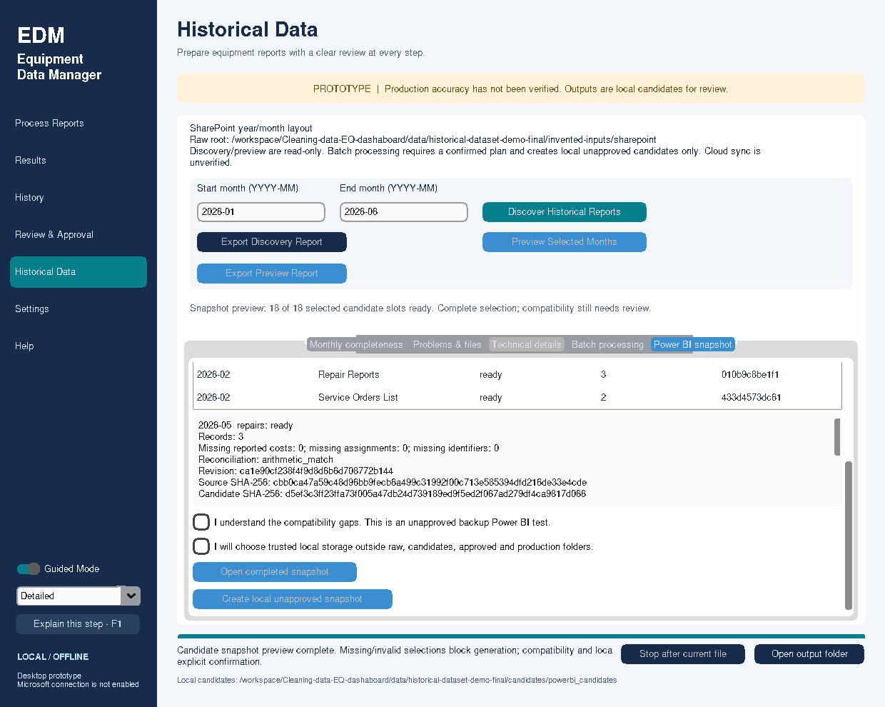

# Historical Power BI Dataset Generator

This feature starts from owner-merged main **eea5d01** (PR #23), on
`feature/historical-powerbi-dataset`. Existing historical processing and corrections
are reused, not replayed. No cleaning, financial schema v2, SQLite schema, approval,
Graph or production Power BI behavior changes. No supplied PBIX is modified.

## Employee workflow

1. Open **Historical Data**. Set the inclusive start/end range (YYYY-MM, maximum
   120 months, including year boundaries). Existing single-month preferences stay separate.
2. Open **Power BI snapshot → Preview selected candidates**. This reads current
   manifest selections, not raw files or prior review packets. It can run independently
   of historical discovery/preview; no candidate or manifest is created by this preview.
3. Inspect each report slot's availability, integrity, records, revision, warnings,
   missing costs/assignments/IDs and reconciliation. No missing report is treated as zero.
4. All three report types must be selected and valid for every month. There is no
   incomplete-export exception. Resolve missing/invalid slots in the existing processing/
   individual correction workflow, then preview again. Never edit the manifest by hand.
5. Read [compatibility findings](historical_powerbi_compatibility.md). Acknowledge
   unresolved mappings and confirm a trusted local destination. These acknowledgements
   establish test intent only, never business approval. Creation also requires a dialog.
6. Choose a local parent outside raw/candidates/reserved approved/sync/production
   locations. The app creates a fresh `PowerBI_Historical_Test_<random>/snapshot`.
7. Review results, open the completed snapshot and read `compatibility_report.md`
   and `snapshot_manifest.json`. No automatic import or refresh is performed.
8. For another snapshot, preview again. Old snapshots remain; dataset CSV bytes and
   hashes are identical if the selected revisions/contents are unchanged.

Stop cancels during selection checks or between writes and before finalization.
The worker never calls Tk; progress/results return through the existing queue.
Failed writes/cancellation remove only this run's exclusively owned container;
previous snapshots remain. An abrupt process/OS termination may leave an incomplete
container with `.s`, never a completed `snapshot` directory. Do not import or resume
it; retain for diagnosis and generate a new snapshot after fresh preview/confirmation.
There is no automatic cleanup of other runs or automatic resume.

## Output structure and contracts

```text
PowerBI_Historical_Test_<id>/
  snapshot/                         # Appears only after all outputs validate
    Repairs_History.csv
    ServiceOrders_History.csv
    TMAWorkOrders_History.csv
    RepairFinancialSummaries.csv
    snapshot_manifest.json
    compatibility_report.md
```

See [ordered CSV field/type reference](historical_dataset_columns.md). Original
normalized columns are preserved in order, with four appended fields:

| Field | Meaning |
|---|---|
| ReportingMonth | YYYY-MM alias of the original ReportMonth |
| CandidateRevisionId | Exact committed, selected revision, never a directory scan |
| CandidateOutputSHA256 | SHA-256 of the original monthly main candidate CSV |
| CandidateCleanerVersion | Manifest cleaner/export identity for that revision |

Repair summary rows carry the **repair main candidate** revision/hash in those
four columns. The manifest selection's summary_sha256 is the original supplemental
CSV digest, bound by FinancialSummarySHA256 in each original repair row. It is not
the digest of the combined summary file. Dataset hashes separately identify the
four combined outputs. SourceFileSHA256 identifies original source bytes as recorded
by processing; snapshot generation does **not** reread originals or establish
independent source/business accuracy (`source_bytes_verified: false`).

Repairs keep financial schema 2; service/TMA keep their existing schema 1. Historical
snapshot schema is **historical-powerbi-v1**, a new container contract, not a financial
schema change. UTF-8, LF rows, header-first, ISO date-only strings, original decimal
strings, blank nulls and text IDs remain. No Excel auto-formatting is applied.
Records sort by month then original candidate order, whose ordinals are verified.
Repeated business IDs and transactions remain. No March/dashboard exclusion is added.

RepairFinancialSummaries copies one bound monthly source summary, including known
subtotal, missing count, differences and reconciliation status. Additional fields
EstimatedLaborCostSum, LegacyPartsCostSum, LegacyLaborCostSum and
LegacyEstimatedTotalCostSum only sum the existing candidate values. Each has a
corresponding *MissingCount. A sum is blank when any contributor is missing. These
are labeled controls, not recalculated cleaner amounts or per-repair allocations.
Do not combine partial KnownRepairTotalCost values into a purported complete total.

## Manifest contract

`snapshot_manifest.json` includes:

- snapshot_schema, financial_schema_version, start/end, complete and configuration
  fingerprint (workspace paths are hashed, not disclosed in this fingerprint).
- Exact selections per month/type: revision, source/output/summary hashes, supported
  cleaner version, records, stored warnings, reconciliation and missing-value counts.
- datasets: four exact filenames, ordered columns, SHA-256, record count and
  rows_by_month. The manifest also counts repeated work-order ID occurrences without
  listing the IDs; this is a diagnostic, not a deduplication rule.
- plan_sha256, created_utc and compatibility_report_sha256. Only metadata timestamps
  vary between repeat runs. Dataset content remains deterministic for the same revisions.
- status CandidateUnverified, production_ready false, business_verification Unverified,
  approval_status NotApproved, compatibility_gaps_acknowledged true, and
  compatibility_policy canonical_no_dashboard_exclusions.
- missing_selections and explicit_exclusions are empty for finalized snapshots because
  the completeness policy blocks gaps and canonical generation excludes no selected rows.
  The read-only preview separately reports missing/invalid/not_assessed slots.

The manifest is an auditable integrity description, not a signed approval or a defense
against an attacker who can rewrite the entire private snapshot and all its hashes.
Treat all CSVs, manifests and reports as private operational data.

## Integrity, concurrency and local storage

`historical_dataset.py` is a GUI-independent reader/generator. It selects only
`candidate_folder/powerbi_candidates/manifest.sqlite3` active rows. It validates
active-to-revision type/month identity, UUID/hash format, counts, supported exact
cleaner identity, schema/provenance, row dates and bound repair-summary consistency.
It reuses read_table and existing readiness record/financial checks. It never calls
clean(), process(), manifest transactions or revision-selection APIs. No source files,
selected revisions, review requests or approval records are written.

Preview fingerprints exact selections/configuration. Generation rereads and compares
that evidence; stale corrections or changed files block the write. The read-only SQLite
transaction stays open through finalization. Supported default DELETE journal readers
prevent a concurrent local selection writer from committing while generation uses it;
unsupported journal modes fail explicitly. No WAL toggle, DB migration or distributed
lease is introduced. Independent snapshots may run concurrently; an exclusive output
container prevents collisions, and one writer cannot delete another's container.

All data is read from the same bytes whose hashes are checked. Supplemental digests
are bound by the hashed main repair candidate. Orphan/unselected versions never qualify.
Symlink/junction rejection covers candidate and destination ancestors/artifacts.
Destinations must pass existing fixed-local/unsynced policy and cannot overlap configured
raw, candidates or reserved-approved locations. Known sync-client checks cannot prove
absence of every possible sync system; explicit local confirmation is still required.
Do not select an unconfigured production ingestion folder. Graph is never constructed.

The staging directory `.s` is inside an exclusively owned new output container. Files
are exclusive-written, fsynced, read-back hashed and contract-checked before renaming
`.s` to `snapshot`. No existing directory is overwritten. This is an atomic directory
visibility boundary on the same local filesystem, not a guarantee against hardware
power loss, filesystem corruption or hostile same-user filesystem changes. Windows
preflight checks staging/final filenames and UTF-16/MAX_PATH bounds before creation.
Do not disable Windows checks or change long-path registry policy to force a run.

## Exact Windows / VS Code acceptance

Close the app before updating dependencies. Open the actual Git clone, not the old
Downloads prototype directory. Keep local edits safe before switching.

```powershell
cd "$env:USERPROFILE\Cleaning-data-EQ-dashaboard"
git status --short
git fetch origin
git switch feature/historical-powerbi-dataset
# If needed: git switch --track origin/feature/historical-powerbi-dataset
git pull --ff-only
git rev-parse HEAD
python -m uv sync --frozen --all-extras
python -m uv run --frozen --all-extras python -c "import equipment_data_manager.historical_dataset as m; print(m.__file__)"
python -m uv run --frozen --extra desktop python -m equipment_data_manager.ui.app
```

Start with a new, invented six-month demonstration. It generates both raw folder
layouts, processes through the real engine, then creates two complete snapshots
and compares their dataset hashes (no private data needed):

```powershell
python -m uv run --frozen --all-extras python examples/create_historical_dataset_demo.py --output data/historical-dataset-demo
```

For actual January–June, use the existing trusted local candidate store in Settings;
do not reprocess or correct anything just to force snapshot completeness. Preview
2026-01 through 2026-06. Check all 18 current selections, especially January/February
TMA. Inspect missing-value and financial warnings before acknowledging compatibility.
The owner previously observed the following retained counts; these are **not** code
rules or proof of the selections in your current manifest:

| Month | Repairs | Service | TMA |
|---|---:|---:|---:|
| January | 29 | 29 | 38 |
| February | 5 | 5 | 67 |
| March | 17 | 17 | 69 |
| April | 33 | 35 | 59 |
| May | 55 | 57 | 81 |
| June | 69 | 70 | 70 |

Generate into a separate private local parent. Check all four CSVs and rows_by_month.
Keep March's missing cost, April's cross-period service completions, May/June missing
costs/assignments and any other current warnings. Compare selection revision IDs before
and after; no revision should change. Generate a second snapshot without reprocessing.
Verify one completed directory at a time, then compare dataset digests:

```powershell
$first = Read-Host 'First completed snapshot folder (ending in snapshot)'
$second = Read-Host 'Second completed snapshot folder'
python -m uv run --frozen --all-extras python -m equipment_data_manager.historical_dataset --verify-snapshot "$first"
python -m uv run --frozen --all-extras python -m equipment_data_manager.historical_dataset --verify-snapshot "$second"
$a = Get-Content (Join-Path $first 'snapshot_manifest.json') | ConvertFrom-Json
$b = Get-Content (Join-Path $second 'snapshot_manifest.json') | ConvertFrom-Json
Compare-Object ($a.datasets | ForEach-Object { "$($_.file):$($_.sha256)" }) ($b.datasets | ForEach-Object { "$($_.file):$($_.sha256)" })
```

Expect no dataset-hash differences. Creation timestamps may differ. Confirm no files
appeared in reserved-approved/production locations and that Approve/Publish remain
disabled. Real-data snapshot acceptance remains owner-pending until this run completes.

## Backup PBIX import

Read the compatibility guide first. Work only in a separately saved PBIX copy.
Use Blank Query → Advanced Editor to paste `powerquery/fnReadHistoricalSnapshot.pq`
and name the function **fnReadHistoricalSnapshot**. Define a text parameter
**HistoricalSnapshotFolder** containing one completed local `snapshot` path.
Create four new comparison queries:

```powerquery
= fnReadHistoricalSnapshot(HistoricalSnapshotFolder, "repairs", true)
= fnReadHistoricalSnapshot(HistoricalSnapshotFolder, "service_orders", true)
= fnReadHistoricalSnapshot(HistoricalSnapshotFolder, "tma_work_orders", true)
= fnReadHistoricalSnapshot(HistoricalSnapshotFolder, "repair_financial_summary", true)
```

Each line belongs in a separate Blank Query. The explicit true enables unapproved
backup-test input, not approval. M validates exact headers, counts, month coverage,
revision bindings and typed values; run the Python hash validator first. M does not
cryptographically verify hashes. No Folder.Files or concatenation of snapshots is used.
M syntax/offline contract checks do not establish execution in Microsoft's runtime.

Initially leave these as comparison tables without relationships. Compare shared months
and every relevant visual/measure with the existing tables. Preserve text IDs and date
keys; check blank/missing amounts separately. Preserve existing table identities,
dimensions, calculated columns, DAX and relationships when planning a later source-step
migration. Do not replace both TMA tables or switch legacy financial meaning silently.
No full-dashboard compatibility or production migration is claimed by this milestone.

## Developer validation

```powershell
python -m uv run --frozen --all-extras python .github/run_tests.py
python -m uv build
python -m uv run --frozen --all-extras python -m equipment_data_manager.ui.app --smoke-test --smoke-dir data/historical-dataset-source-check
python -m uv run --isolated --no-project --with './dist/equipment_data_manager-0.2.0-py3-none-any.whl[desktop,microsoft]' python -I -m equipment_data_manager.ui.app --smoke-test --smoke-dir data/historical-dataset-wheel-check
.\packaging\build.ps1
```

On Linux use an active display and `--isolate-gui` on the full runner. Every GUI test
runs in a fresh process, with no skips/retries. Do not run GUI suites/smokes on the
same display concurrently. Native packaged desktop smoke now reaches **phase 49**,
creating/repeating/hash-validating snapshots, with a separate-process restart.
Require hosted Windows/Linux and native packaging checks on the exact feature head
before recommending merge. Do not merge automatically.

## Synthetic desktop preview

This is the actual local desktop showing invented six-month candidate selections;
it is not a claim of departmental validation.



The Windows packaged wrapper allows 180 seconds for startup plus the unchanged
90-second desktop and 35-second restart inner checks. `smoke-progress.json` records
only phase, stage, elapsed time and worker/job states, never report cells. CI emits
these fields as notices and retains them with diagnostics on failure. A successful
build alone is not a successful packaged desktop test.
