# Consolidated integration baseline — 2026-10-29

Branch: **integration/stable-baseline**, target: **main**. Review only: no default-
branch merge, production write, live authentication or candidate approval occurs.
The audited integration merge is **9d07ceda09e48eb607bd3bdb6b094d87c3d43b1b**;
subsequent commits document/verify it and extend CI/executable smoke assertions.
Use `git rev-parse HEAD` to record the exact final review/build identity.

## Strategy and dependency map

[Full branch/PR audit and exact included commits](integration_branch_audit.md).
Git confirms all remote feature tips are included. PR #13 was owner-merged into
Power BI readiness at ae9a865; its tree exactly equals 14f4401. Earlier PR bases
are last-known metadata; live PR state/reviews/checks remain inaccessible.

```mermaid
flowchart LR
    M0[2889796 M0] --> M1[0449dce M1]
    M1 --> GUI[742fd35 Desktop]
    GUI --> FEB[01237e5 February service]
    FEB --> MULTI[e4c4ad2 Multi-month]
    MULTI --> DIAG[631f9c6 Diagnostics]
    DIAG --> CSV[74cb7d3 Power BI candidates]
    CSV --> MONTH[456440d Monthly workflow]
    MONTH --> UX[25d7a28 Settings and Guide]
    UX --> PILOT[6857953 Power BI pilot]
    PILOT --> FIN[bffd53f Financial v2]
    FIN --> READY[454c7a0 Readiness]
    READY --> GRAPH[14f4401 Offline Graph foundation]
    READY --> OWNER[ae9a865 Owner PR13 merge]
    GRAPH --> OWNER
    M0 --> MAIN[06be863 main M0 merge]
    MAIN --> INTEGRATE[9d07ced Integration merge]
    OWNER --> INTEGRATE
```



One history-preserving merge from main includes the complete chain without
cherry-picking, rebasing, force-pushing or sequentially merging every stacked PR.
No conflicts occurred; the initial merged tree is byte-identical to ae9a865.
Main's own M0 merge commit is preserved. No feature branch has been rewritten. The integration-only executable-check commit is
956f50d; final documentation is a separate reversible commit.
The project version remains 0.2.0: identify this prototype by commit and ZIP hash,
not just the reused artifact/version name. No new product features/dependencies,
financial rules, schemas, SQLite migration or settings-format change is introduced.

## Preserved functionality and evidence

| Area | Included implementation | Evidence / boundary |
|---|---|---|
| Desktop | CustomTkinter first run, Settings/restart, Guide/tooltips/F1/offline Help, month discovery, preview, responsive processing, results/history, explicit corrections and packets | Real-window synthetic tests and source smoke on Linux; exact-head Windows executable acceptance outstanding |
| Cleaning | Supported repair/service CSV adapters, UTF-8 BOM, January/February layouts, TMA XLSX, date/exclusion diagnostics, text IDs, raw preservation | Existing compatibility/characterization tests preserved; unseen layouts and legacy XLS remain unsupported |
| Safety | Source identity/hashes, strict period/schema checks, SQLite-selected immutable revisions, duplicate skips, bound correction confirmation | Synthetic failure/integrity tests; local single operator, not cross-PC locking |
| Financial v2 | ReportedTotalCost distinct from EstimatedLaborCost and explicit legacy fields; raw amounts and one monthly summary with reconciliation/hash provenance | Synthetic financial/grain/null/disagreement tests; unequal nonzero field meanings and estimate policies still require business decisions |
| Power BI | Candidate CSVs, explicit four-folder snapshots, v2 M functions, shared months, source hashes, independent expectations/reconciliation, backup-model procedure | Offline tests and M syntax parsing; owner reports real January/February v2 Desktop success, not agent-run or production approval |
| Storage | Local/synced providers, placeholder/partial/version/hash checks and engine bridge | Synthetic tests; local byte stability cannot prove cloud sync or export completeness |
| Graph/auth | Injected offline Graph list/download/retry/integrity; MSAL-compatible session and Windows DPAPI cache component | Mock tested; no real MSAL/HTTP bootstrap, no live sign-in, no arbitrary publication; native Windows DPAPI needs hosted evidence |
| Inventory/classification | Design and owner-reported separate Power BI inventory matrix | No verified application inventory adapter or classifier; not part of monthly completeness |

The approved root remains reserved and untouched. All candidates remain
CandidateUnverified even when financial arithmetic matches. Legacy calculations
are retained; v2 does not relabel the individual total as parts or allocate monthly
parts/labor onto repairs. Original six uploads and all existing tests remain intact.

## Reproduced checks

Local environment: Linux, Python 3.12.14, frozen uv all-extras environment, real Xorg
dummy display, GUI cases isolated once each without retries or omissions.

| Check | Observed result |
|---|---|
| Complete regression suite | **473 passed; 0 failures, errors or skipped** on consolidated tree |
| Source desktop smoke | Passed through phase 24 and separate-process Settings restore; final smoke also requires v2 columns/summary, packet companion, sync caveat and disabled Graph |
| Wheel and source distribution | Built successfully; isolated installed-wheel walkthrough/assessment and actual GUI/restart smoke passed; sdist installed/config smoke passed |
| Two-month synthetic pilot | Four datasets, source-index hashes and independent invented expectations passed; candidate only |
| Installed-wheel Graph preview | In-memory transport to real engine succeeded; no output or live authentication |
| Power Query syntax | All **15** .pq files accepted by @microsoft/powerquery-parser 4.0.0; not mashup/DAX evaluation |
| Windows executable build/smoke | **Not executed here**: Linux cannot cross-compile Windows; hosted results unavailable |
| Hosted Windows/Linux CI | **Unverified**: GraphQL/REST CONNECT proxy returns HTTP 403 Forbidden |

Ignored local evidence is in data/integration-final-tests.log, data/ci-test-results.xml,
data/integration-final-build.log, data/integration-final-desktop-smoke/ and
data/integration-final-wheel-readiness/. These are development artifacts, not a public
release or private-data approval record. See [testing](testing.md) and
[development](development.md) for repeatable commands.

CI retains both OS full-suite/wheel/pilot checks. Windows packaging and executable
smoke now also run on integration-branch pushes, so a blocked PR API need not
prevent the checks being scheduled. A workflow_dispatch entry is provided too;
GitHub may expose dispatch only once the workflow exists on default. No success is
inferred from scheduling/configuration. No Windows runner is attached locally.

## Owner-only January/February verification

Use only your private original files and independently confirmed targets supplied
in the integration request. No departmental reports, real snapshots, expectation
CSV or source-index paths are committed. Synthetic fixture amounts are invented
and must not substitute for those targets.

1. Close the app, open the Git clone rather than a downloaded executable folder,
   switch to this branch and install frozen dependencies as described below.
2. Keep candidate SQLite/history on trusted local disk. Select January and the
   three supported raw reports; preview, inspect dates/exclusions/warnings, process,
   then export a review packet. Repeat for February. Confirm intended revisions;
   corrected months require explicit review and preserve the previous bytes.
3. Follow [the real-data SOP](powerbi_real_data_readiness.md), sections 4–6:
   assemble explicit packets with --require-repair-v2 into a new private destination,
   generate a private expectations grid, enter the known January/February/combined
   repair/service/TMA counts and reported parts/labor/total targets independently,
   and index the six original sources. Require source_bytes_verified,
   reported_financials_reconcile and expected_totals_match. Investigate every
   null/difference; never change rules to meet a target.
4. Check identifiers as text, ISO dates, numeric hours and legitimate repeats;
   compare monthly summary totals once per month, never once per transaction.
   Preserve private checksums, expectations, assessment and reviewer/build identity.
5. Use a new local PBIX or carefully isolated backup, following
   [backup migration](powerbi_backup_migration.md). Import the exact four snapshot
   folders and shared months. Inspect M errors, DAX, relationships, filters, financial
   and hour/capacity visuals. Do not Refresh All on live connections, publish or
   overwrite production. Do not label the candidate approved.

The owner reports prior successful schema-v2 imports/visuals. A repeat at the exact
integration build remains an owner-run acceptance record, not independent CI evidence.

## Windows and CI blockers

Git fetch/list/push succeed. `gh pr list` GraphQL and `gh api .../actions/runs`
REST fail Forbidden; unauthenticated `curl -I https://api.github.com` independently
fails CONNECT HTTP 403 from envoy. This does not diagnose bad GitHub credentials.
The prior environment configuration already allowed api.github.com. Runtime
network-policy review/reapplication remains needed; no proxy bypass or new secret
is requested. Current PR/CI/branch-protection state cannot be fully audited here.

Open the Actions page manually for **this exact integration head**. Require both
OS suites and Windows build + actual packaged smoke/artifact results. Download and
extract the complete successful prototype ZIP, verify SHA-256 and commit, then test
on a separate managed Windows PC without Python/Git/VS Code using the
[Windows checklist](windows_packaging.md). Failed/missing checks block final merge;
local Linux success is insufficient. Employees must not bypass endpoint protections.

## Review, final merge gate and rollback

Base **main**; compare **integration/stable-baseline**. If API creation is blocked,
use [manual PR creation](https://github.com/walker2023-glitch/Cleaning-data-EQ-dashaboard/compare/main...integration%2Fstable-baseline?expand=1).
No PR is claimed until GitHub actually returns its URL. Retain existing branches/PRs.

**Do not merge now.** Before recommending a merge, obtain missing Windows/hosted
checks, inspect current reviews/protections and recheck that main and every intended
feature head have not advanced. Incorporate later changes on the integration branch
and revalidate if needed. Confirm no sensitive files, exact PR head and owner explicit
final approval. Then an authorized maintainer can run, substituting verified values:

```sh
gh pr checks PR_NUMBER --required --watch
gh pr view PR_NUMBER --json baseRefName,headRefName,headRefOid,reviewDecision,mergeStateStatus
# Only after the owner explicitly approves the verified final commit:
gh pr merge PR_NUMBER --merge --match-head-commit VERIFIED_FULL_HEAD_SHA
```

Use a merge commit to retain the audited history; no squash/rebase, --admin,
--auto, forced updates or branch-protection bypass. A missing required-check
configuration is not equivalent to all workflow jobs passing: inspect both OS jobs
and packaged smoke explicitly. After merge, start future feature branches from
updated main. Reviewers may then close superseded stack PRs as included, with links;
that cleanup is not performed here.

Backups: backup/pre-integration-main-2026-10-29 at 06be863 and
backup/pre-integration-sharepoint-2026-10-29 at 14f4401. Before final merge, rollback
means leaving main unchanged and closing the review PR; no reset is necessary.
After an approved merge, if rollback is needed, open a **separate reviewed** revert
PR using `git revert -m 1 FINAL_MAIN_PR_MERGE_SHA`, review its diff, run required
checks and obtain approval. Never reset/force-push main. A code revert cannot undo
processed user data: back up local candidate/settings stores before changing builds
and restore an entire known-good store to a separate local location if needed.
No data/schema migration is introduced by consolidation. Do not delete history or
edit SQLite to force compatibility; production refresh/publication remains absent.

## Remaining decisions and next milestone

The baseline is locally validated and reviewable; it is **not yet fully validated
for final merge**. Immediate next gate is exact-head hosted Windows build/smoke and
second managed-PC acceptance, then explicit owner review of this integration PR.
After an approved merge, branch future work from main, not the old feature stack.

Next implementation milestone: a small **authorized read-only SharePoint test-site
pilot** only after IT registration, least-privilege delegated grants, exact test
resources, cache/ACL/sign-out/device/proxy and executable policies are approved.
See [IT checklist](sharepoint_live_pilot.md). Live MSAL/HTTP construction, account/
site selection and permission recovery must be tested separately from publication.
Without those approvals, focus on employee/recovery acceptance or verified inventory
fixtures; do not invent a connector or an inventory contract.

Business decisions remain in [management decisions](management_decisions.md):
nonzero unequal repair subtotals, labor-rate/default hours, nullable-money precision,
cross-month service interpretation, zero-activity policy, retention/support owners,
authenticated approvals/concurrency and production publication. Successful January/
February arithmetic/imports do not resolve those decisions or authorize production.
