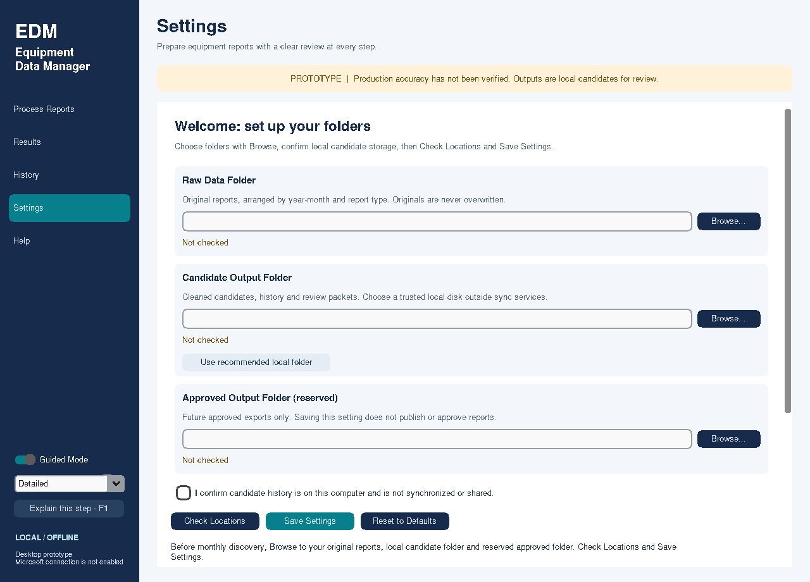

# Settings and first-run setup

## Reporting-month preference (settings v2)

After setup has been saved, valid month/year changes are remembered in the same
local profile and restored on restart. Review and Process Reports share the selector.
Processing confirmation and previews are never restored. First-run selection alone
writes no profile; Save Settings enables persistence. Invalid edits or failed writes
retain the last saved period and display a session-only/error message.

Version-1 settings and legacy folder imports still load. New saves use version 2
with reporting_period; blank means no remembered month. An older v1-only build
cannot read v2, so keep a private settings backup before rollback. Reset forgets
the remembered period; drafts/imports do not silently change the active month.
See approval_ux_identity_readiness.md. No candidate/request/financial data is migrated.

Ordinary use requires no TOML editing, Python or terminal. Open the Windows review
build and use **Settings**. On a normal first launch, this page opens automatically.

1. **Raw Data Folder → Browse**: choose the root containing your original monthly
   exports. Arrange them with Explorer as year-month / repairs, service_orders and
   tma_work_orders. See the [monthly procedure](monthly_workflow.md) for the layout.
2. **Candidate Output Folder → Browse**, or **Use recommended local folder**:
   select a trusted local disk outside OneDrive/SharePoint/network sync. The
   recommended Windows location is under Local AppData, EquipmentDataManager /
   Candidates. Confirm the local-storage checkbox. No folder is created by merely
   selecting a path.
3. **Approved Output Folder → Browse**: reserve a separate location. It must not
   contain, or be inside, either of the other folders. This is not an active
   publishing destination. No candidate reports are written there.
4. **Check Locations**: read the indicators. Ready means the current local checks
   passed; Needs creation requires confirmation; Needs attention must be resolved.
   Missing folders can be created only after the dialog lists them and you agree.
   An approved folder created this way is empty/reserved, not a published dataset.
5. Choose **Power BI CSV candidate** (recommended) or Legacy candidate as your
   preferred format. **Save Settings** applies and remembers the choices, clears
   old previews/correction acknowledgements, then opens Process Reports.

Save, Check and Reset stay visible below the scrollable form. Scroll to preferences
or Advanced Settings when needed. Text fields are read-only but can be selected
for copying; Browse handles paths, including spaces and Unicode. Changing locations
never moves/deletes reports or migrates existing history. To retain prior history,
choose its existing **base candidate folder**, not its powerbi_candidates or
versions subfolder. Legacy and normalized histories remain separate.

## Remembered choices and recovery

Normal Windows launches save a private version-1 TOML file at
`%LOCALAPPDATA%\EquipmentDataManager\settings.toml`. Linux uses
`$XDG_CONFIG_HOME/EquipmentDataManager/settings.toml` (default ~/.config);
macOS uses the user's Library/Application Support/EquipmentDataManager folder.
Only folders and Guided Mode/detail/output-format/local-storage preferences are
stored. No passwords, tokens, Microsoft IDs, report rows or financial approvals
are stored. The file is UTF-8 with escaped path strings, written through a flushed
and fsynced temporary file and atomic replacement in the same directory.

Next launch restores valid settings and opens Process Reports. Startup reads/checks
folders in the background and creates no data folders. If a location is missing,
offline, inaccessible or unsafe, Settings opens with your saved choices retained.
Fix the indicators and save again. If the settings file is corrupt or unreadable,
it is retained; you can choose folders again and explicitly Save Settings or
confirm Reset. Guided Mode changes in that recovery state apply only to the current
session until valid settings are saved, protecting the unreadable file.

**Reset to Defaults** requires confirmation. It forgets folder choices, restores
Guided Mode Detailed and Power BI CSV Candidate, and returns to setup. It never
deletes data/history/review packets. To undo a mistaken reset, reselect the former
folders or import your private workspace configuration; it does not erase the store.
Use one app/operator at a time. Atomic settings writes prevent partial files, not
cross-process settings merge conflicts; concurrent instances use last successful
settings replacement. Unavailable settings storage gives a safe message without
exposing source values, and the previously saved file remains intact.

## Local-storage checks and their limits

Raw/approved folders may be authorized locally available synced locations. Their
availability is not evidence of OneDrive/cloud completion. Candidate history must
be on a trusted local disk: known OneDrive environment/account roots, obvious sync
folder names and UNC paths are rejected. Windows also rejects non-fixed drives,
redirected/junction/cloud-managed candidate ancestors. Linux rejects recognized
network/FUSE mounts. The app checks resolved folder separation and access, reading
directory metadata; an explicit Check/Save can create/remove a temporary access
probe in the candidate folder. No original report is touched.

These checks cannot prove that every third-party sync client or IT redirection
has been discovered. The checkbox records your declaration, not a verified cloud
or IT certification. Use the recommended local folder, or ask IT to approve a
custom location. If blocked, choose a genuinely local location; do not rename a
sync folder to bypass the check or alter device permissions. Future approved-folder
write permissions/Graph access are not certified by local access checks.
Creating empty folders inside a sync root may be synchronized by your external
client; use authorized pilot locations. The app does not observe/verify that sync.

## Advanced compatibility and sanitized export

Expand **Advanced Settings** to import a versioned settings TOML or the prior
three-folder workspace TOML. Imported choices are a **draft**. Reconfirm local
candidate storage, check and save before applying/persisting. Relative imported
paths resolve beside the imported file. Unknown keys/credential fields are rejected.
`settings.example.toml` shows the supported versioned shape; employees need not edit it.

**Export Sanitized Template** creates a separate .toml with blank paths and default
preferences, omitting your actual folder names and choices. It is not a backup.
The native save dialog confirms replacement of an existing destination. You cannot
export over the active settings file or a CSV/XLSX report.

The old **Load folder configuration** and **Choose output folder** controls remain
under Advanced Settings for session-only compatibility. They do not remember a
new workspace on their own and still block detected unsafe candidate locations.
Use the form's Browse/import and Save for ordinary persistent configuration.
The original Microsoft `config.example.toml` is a separate inert offline template;
it is not the employee settings format and cannot enable authentication.

For developers, explicit --output-dir or an injected workflow keeps isolated
session behavior and stores preferences inside that output root only if changed.
Use --settings-file with a fresh .toml under ignored data/ to test full automatic
startup without touching your normal profile settings. See the source repository’s development.md section “Settings and Guided Mode preview.”
